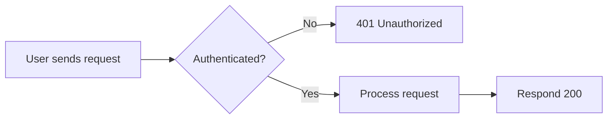
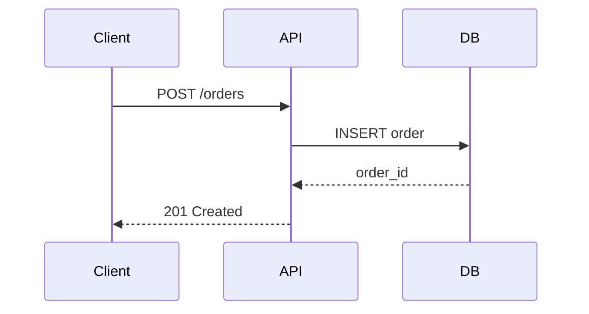
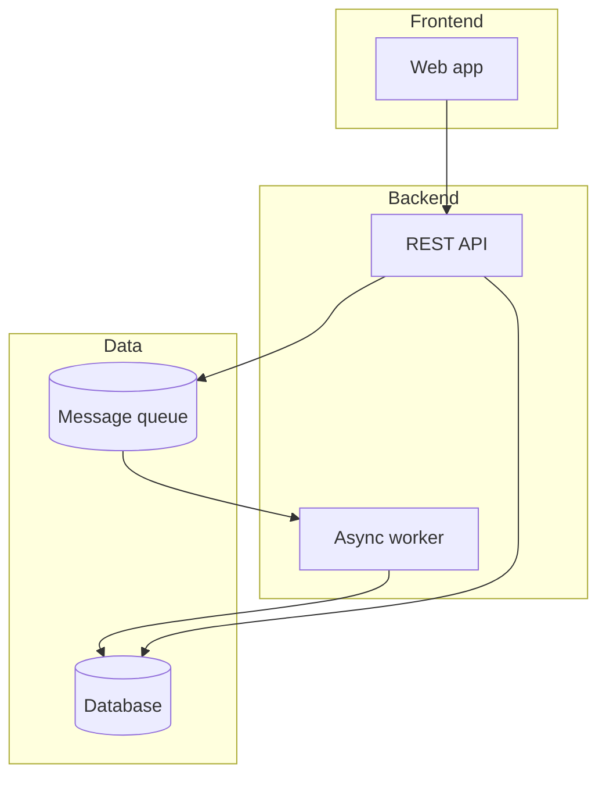

# Cheatsheet: Diataxis + Mermaid

## Where does this content go?

| Question | Type | Folder |
|---|---|---|
| Does it teach from scratch how to accomplish something, step by step? | Tutorial | `getting-started/` |
| Does it solve a specific task for someone with prior knowledge? | How-to guide | `guides/` |
| Is it the exact spec of a function/class/endpoint? | Reference | `reference/` (auto-generated) |
| Does it explain the "why" behind a decision or the overall design? | Explanation | `architecture/` |

Don't mix types in the same document: a tutorial shouldn't dive deep into theory, and a reference page shouldn't include design opinions.

## Mermaid diagram examples

### Process flow

### Interaction between components

### High-level architecture

## Quick checklist before finishing a docs task

- [ ] The new file is in the correct folder per the table above
- [ ] It's added to the `nav` in `mkdocs.yml`
- [ ] If it touches public code, the reference (`reference/`) was updated via `::: module`, not by hand
- [ ] If it's an architecture decision, it has its ADR under `architecture/decisions/`
- [ ] `mkdocs build --strict` passes with no warnings
