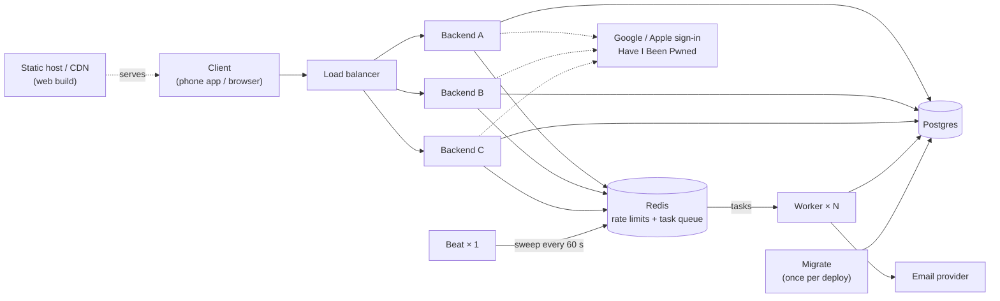

# Backend Template

A ready-made backend for apps that need user accounts, so you don't have to build
sign-up and login from scratch again. It's written in
[FastAPI](https://fastapi.tiangolo.com/) (Python), and comes with a demo app to click
through it.

Start your project from it, add your own features next to the accounts, and deploy it as
one Docker image that runs as many copies as your traffic needs.

## Why start from it

- **The easy-to-miss security details are done.** Sign-up and "forgot password" give the
  same answer, in the same time, whether or not the email has an account, so nobody can
  use them to find out who is registered. Passwords are hashed with argon2 and checked
  against known leaks. Login tokens are stored only as hashes, and a stolen one gets its
  whole session revoked the moment it's reused.
- **It scales out, and that was measured.** Any copy of the backend can answer any
  request. Load tests on AWS showed capacity growing in step with the number of copies,
  from one to eight. See [Does it scale?](#does-it-scale).
- **It's tested and documented.** Every feature came with its tests written first, and
  end-to-end tests drive the demo app in a real browser. The documentation explains how
  each piece works and why it was built that way.
- **It stays out of your way.** The user model is nearly empty and nothing assumes a
  particular kind of app. You add what your product needs.

## What you get

- **Accounts:** sign up, confirm your email, log in, log out, forgot and reset password.
- **Sign in with Google and Apple**, off until you add your keys. An existing account is
  linked only after its owner confirms by email.
- **Sessions that renew themselves**, with detection of stolen login tokens.
- **Rate limiting** that slows down password guessing and other abuse.
- **Email that doesn't get lost:** if the mail service is down, messages wait and go out later.
- **Audit logs** of who did what and when.

## What it leaves to you: authorization

This template knows *who* is making a request (authentication), not *what they're allowed
to do* (authorization). There are no roles, permissions or admin accounts, on purpose.
Those rules come from your product: who owns what, whether users belong to teams or
companies, what each plan unlocks, what can be shared and with whom. A generic roles
table would fit almost nobody and get in the way of the rest.

So build the model your app needs. Every protected endpoint already receives the
signed-in user (`CurrentUserDep` in `backend/src/backend/auth/dependencies.py`), and
that's where your checks start: compare the user with the thing they're asking for, or
write a dependency of your own that does.

## Try it

You need [Docker](https://docs.docker.com/get-docker/). From the root of the project:

```bash
docker compose -f docker-compose.yml -f docker-compose.local.yml \
  --env-file deploy/local.env up --build
```

The API answers on <http://localhost:8000> (interactive docs at `/docs`), and every email
it sends lands in Mailpit at <http://localhost:8025>. To work on the code itself you'll
also want [uv](https://docs.astral.sh/uv/) for the backend and Node.js for the frontend;
[Getting started](docs/getting-started/index.md) walks through both.

## Start your own project from it

On GitHub, click **Use this template** to create your own repository from this one. Your
copy starts with a single commit of the current code, without this repository's history,
so the project is yours from the first commit. Clone it and follow
[Getting started](docs/getting-started/index.md).

## How it runs



All of it is one Docker image started with different commands:

- **Backend:** the API. Run as many copies as you need behind the load balancer.
- **Worker:** sends the emails. The backend never calls it directly: it saves the email
  in Postgres and leaves a task in Redis, and a worker picks it up. If every worker is
  down, the emails wait.
- **Beat:** a timer that, every minute, asks a worker to resend any email that got stuck.
  Run exactly one.
- **Migrate:** updates the database tables, once per deploy, before the new backends start.

Postgres holds all the data. Redis isn't a cache: it counts requests for rate limiting and
carries tasks to the workers. In production, use managed versions of both, plus your
hosting's load balancer. Any copy of the backend can answer any request, so running two
or twenty takes no code changes.

## Does it scale?

Yes, by adding copies. It was load-tested on AWS, on a free-plan account, with each copy
of the backend on a small server (half a CPU and 1 GB of memory). In every scenario,
twice the copies handled twice the traffic, from one copy up to eight:

| What the users do | Per copy | Eight copies |
|---|---|---|
| Log in | 8 per second | 64 per second |
| Use the app while logged in | 80 requests per second | 640 per second |
| Sign up | 6 per second | 48 per second |

Logging in and signing up are slow on purpose: hashing a password is designed to cost
CPU, so guessing passwords costs an attacker too. The tests also showed what to grow
next to the backend: the email workers, and the database's connection limit.
[Load tests](docs/architecture/load-tests.md) has the full results and how to run the
same tests yourself.

Does a login API need to scale, though? Rarely. This template is a starting point: you
add your own features next to `auth/` and `mail/`, and they inherit the same stateless
design. That's where running more copies pays off. If all you need is login, a hosted
service (Keycloak, Auth0, Cognito...) may suit you better. When a second copy is worth it,
and what to scale in which order, is in [Scaling](docs/architecture/overview.md#scaling).

## A frontend to try it with

The `frontend/` folder holds a basic app built with [Expo](https://expo.dev/). It runs in
your web browser, so you can click through every screen (sign up, log in, reset your
password) and see the backend working with a real interface instead of raw requests.

It's a template too: every sign-in screen is already built, translated into English and
Spanish, and has light and dark themes. Keep it and build your app on top, or, if you
only want the backend, **delete the `frontend/` folder**. The backend doesn't depend on it.
(The `e2e/` folder tests the two together, so delete it along with the frontend.)

## How it was built

This project was built with AI agents doing most of the typing and a human deciding what
gets in. Each feature went through the same steps:

1. **Plan.** The work is broken into tasks with [Spec Kit](https://github.com/github/spec-kit),
   a spec-driven development framework. Spec Kit and its files are not included in this repo.
2. **Tests first.** One agent writes only the tests for the task, following the project's
   test architecture, and then stops.
3. **Human review of the tests.** I read and approve every test before any real code is
   written. The tests are the contract: if they're right, the code that passes them is too.
4. **Implementation.** A second agent writes the feature. It gets nothing but the task and
   the tests it has to make pass.
5. **Code review.** A third agent reviews the pull request. I decide which of its findings
   are worth tackling, then review the code a second time myself.
6. **Docs.** After merging, a GitHub Action asks an AI model to update the documentation
   and the glossary of terms (the shared vocabulary of the project, in the spirit of
   domain-driven design).
7. **See it working.** Another agent writes end-to-end tests with
   [Playwright](https://playwright.dev/), which drives a real browser, so I can watch the
   feature work with my own eyes.

A note on step 6: the Action uses a free-tier model and the results are poor. It's there to
show that keeping docs up to date *can* be automated. Updating the docs by hand is still
recommended.

## Claude skills included

The project ships the [Claude Code](https://claude.com/claude-code) skills used to build
it, in `.claude/skills/`. Use them as they are or change them however you like.

- **`tdd`**: writes the tests before any code. It also creates the empty files those tests
  need, checks that the tests fail for the right reason, and then stops so a human can
  review them.
- **`docs`**: keeps the documentation site and the glossary in step with the code:
  guides, architecture decisions, diagrams, and an API reference generated from the code.

`CLAUDE.md`, at the root, holds the project's conventions so every agent works the same way.

## Learn more

How it works, how to run it, and why it's built this way are all in the documentation, in
the `docs/` folder. To read it as a website, run this from the root of the project:

```bash
uv run --project backend --group docs mkdocs serve
```

Good places to start:

- [Getting started](docs/getting-started/index.md): run the backend and make your first account.
- [Try it in the web client](docs/getting-started/web-client.md): the same, through the frontend.
- [Architecture overview](docs/architecture/overview.md): how the pieces fit together.
- [Load tests](docs/architecture/load-tests.md): how far it scales, and how that was measured.
