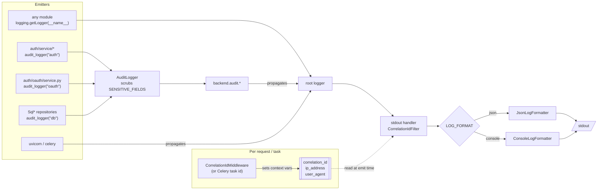

# 7. Structured logs to stdout, with audit events on their own logger

Date: 2026-10-01

## Status

Accepted

## Context

The backend had no logging configuration. The few `logger.warning` calls fell
through to Python's last-resort stderr handler, with no timestamp, no level and
nothing to join the lines of one request. Nothing recorded that a user
registered, that a login failed, or that a stolen refresh token revoked its
family, so the enumeration safety and reuse detection the auth module goes to
lengths for left no trace an operator could read afterwards.

Two constraints shape the answer:

- The API is stateless and scales horizontally. Any number of API and Celery
  worker processes run at once, and none of them owns a disk worth writing to.
- Where the logs go, how long they are kept and who may read them differs per
  deployment. The app should not pick a log vendor for the people running it.

## Decision

Every process writes **one line per record to stdout**, in the format chosen by
`LOG_FORMAT` (`json` for anything that ships logs, `console` for local
development), at the severity set by `LOG_LEVEL`. Routing, retention and access
control belong to whatever runs the process.

Records come in two kinds, told apart by their logger name:

| Kind | Logger | Written with | Carries |
|---|---|---|---|
| Operational log | the module's own, `logging.getLogger(__name__)` | `logger.warning("...")` | a prose `message` |
| `audit_event` | a child of `backend.audit`, one per area | `audit.info(event, **fields)` / `audit.warning(...)` | an `event` name, structured `fields`, `ip_address`, `user_agent` |

The audit areas today are `backend.audit.auth` (signup, login, logout, refresh,
password reset), `backend.audit.oauth` (provider sign-in and linking) and
`backend.audit.db` (one `db_write` per row write, emitted by each `Sql*`
repository method). Every line from one request or Celery task shares a
`correlation_id`.

`backend.log.configure_logging` runs once per process, from `backend.main` for
the API and from Celery's `setup_logging` signal for the worker, and installs a
single stdout handler on the root logger. Uvicorn's and Celery's loggers are
pointed back at the root, so one process emits one format.

Three rules protect what reaches the stream:

- `AuditLogger` replaces any field whose *name* is in `SENSITIVE_FIELDS`
  (`password`, `token`, `email`, ...) with `***` before the record exists.
  Events carry `user_id`, never an email address. A secret passed under some
  other field name is not detected.
- `ip_address` is the ASGI client address, never a raw `X-Forwarded-For`.
  Behind a proxy, uvicorn needs `--proxy-headers --forwarded-allow-ips=<proxy>`.
- An inbound `X-Request-ID` becomes the `correlation_id` only after it is
  reduced to `[A-Za-z0-9_-]` and 64 characters, so it cannot forge a line.

## Alternatives considered

- **Write audit events to a Postgres table.** Durable and queryable from the
  app. Rejected for now: it adds a table, a retention sweep and write load on
  the request path, and the cluster's log stack already offers durable storage
  and retention for any stream it is pointed at.
- **Ship logs from the app** (a vendor SDK, a syslog or HTTP handler). Rejected:
  it ties every deployment to one backend and puts network I/O and its failure
  modes inside the request path. stdout is the one destination every container
  runtime and process manager collects.
- **Record row writes with a SQLAlchemy engine listener** instead of in the
  repositories. It would cover every write, raw SQL and migrations included,
  for free. Rejected because the listener only sees SQL: `revoke_family` knows
  the `family_id` it revoked, a listener sees `UPDATE refresh_token ...
  rowcount=3` and would have to parse SQL to recover it.
- **One flat audit logger** instead of one per area. Simpler, but a line would
  not name its area, and the high-volume `db` writes could not be quietened
  without silencing every audit event.

## Consequences

- The app never loses a log line to a full disk or a dead log vendor, and never
  needs one to start. It also keeps no copy: a deployment that discards stdout
  has no audit trail. Running in production means running with `LOG_FORMAT=json`
  and a collector (see [Use the logs in production](../../guides/logging.md#use-the-logs-in-production)).
- Selecting the audit stream is one rule for any log tool: lines whose `logger`
  starts with `backend.audit`. A handler on `backend.audit` sees every area.
- A repository write method added later emits no `db_write` until someone adds
  the call. Nothing catches the omission.
- `SENSITIVE_FIELDS` matches on field names. A secret is scrubbed only when
  its field is named exactly as listed there (`token_hash`, not `th`).
- Adding an area is one line per module, see
  [Add a logger](../../guides/logging.md#add-an-audit-area).
