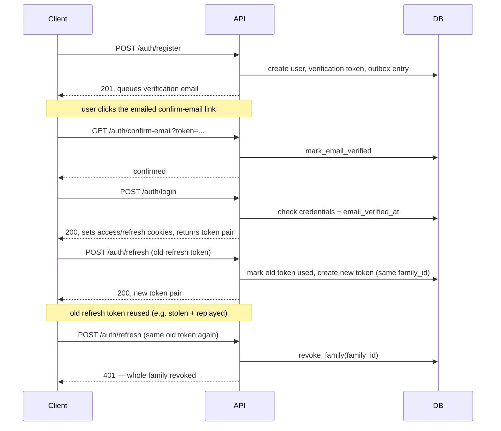
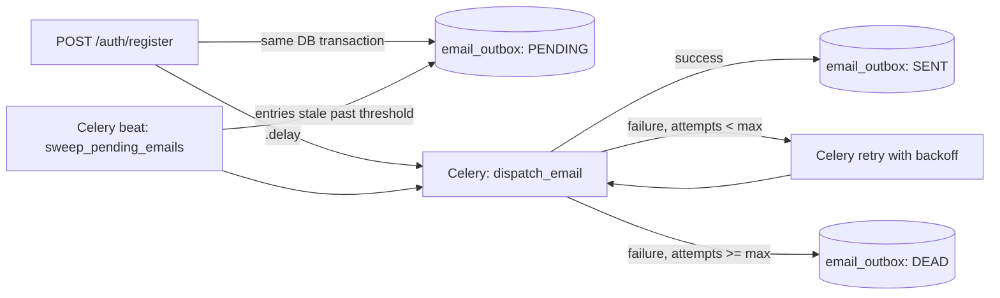

# Architecture overview

`backend/` is a FastAPI app (`backend.main:app`) with two modules so far:

- **`backend.auth`** — registration, login, JWT access tokens, refresh token
  rotation, email verification, and password reset. See the [reference](../reference/auth.md).
- **`backend.mail`** — a durable outbox for outbound email, dispatched by a
  Celery worker. See the [reference](../reference/mail.md).

Redis backs rate limiting (`fastapi-redis-sdk`) and Celery's broker/result
backend. Persistence is via SQLAlchemy + Alembic migrations
(`backend/migrations`), on Postgres (`asyncpg`).

`frontend/` is a separate Expo app; it's the "mobile" client referenced in
the auth decisions below, alongside a browser-based web client.

## Authentication

Login and refresh both return an access token (short-lived JWT, 15 min) and a
refresh token (opaque, 30 days, single-use, rotates on every refresh). Both
are set as httponly cookies *and* returned in the response body, so browser
and non-browser clients can each use the delivery mechanism that fits them.
See [ADR 2](decisions/0002-dual-cookie-and-body-token-delivery.md).

Refresh tokens from one login share a `family_id`. Reusing an already-used
refresh token revokes its whole family — this detects a stolen refresh token
without signing out the user's other sessions. See
[ADR 1](decisions/0001-refresh-token-rotation-with-family-reuse-detection.md).

## Email delivery

Registration and resending verification don't call the email provider
directly — they write a row to `email_outbox` in the same DB transaction as
the triggering action, with an `EmailKind` to select the template, then
queue a Celery task to dispatch it. A periodic sweep re-queues anything left
stuck `PENDING`. This keeps the email durable even if Celery/Redis is
unavailable at the moment of the request. See [ADR 3](decisions/0003-durable-email-outbox-before-dispatch.md).

## Decisions

See [architecture decisions](decisions/index.md) for the reasoning behind
these choices.
