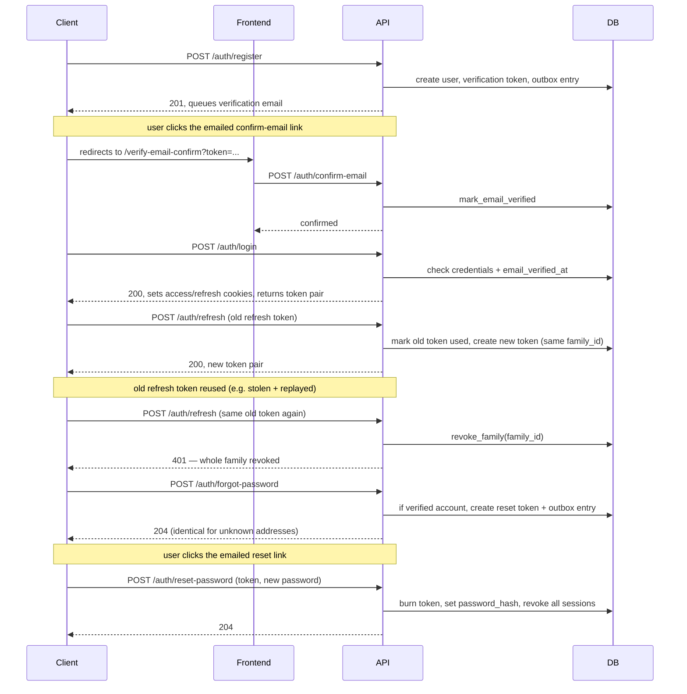
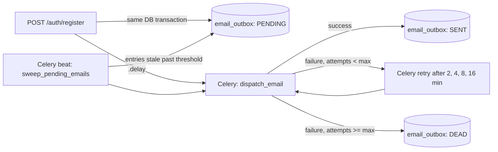

# Architecture overview

`backend/` is a FastAPI app (`backend.main:app`) with two modules so far:

- **`backend.auth`** — registration, login, JWT access tokens, refresh token
  rotation, email verification, password reset, and OAuth provider sign-in
  with account linking. See the [reference](../reference/auth.md).
- **`backend.mail`** — a durable outbox for outbound email, dispatched by a
  Celery worker. See the [reference](../reference/mail.md).

Redis backs rate limiting (`fastapi-redis-sdk`) and Celery's broker/result
backend. Persistence is via SQLAlchemy + Alembic migrations
(`backend/migrations`), on Postgres (`asyncpg`).

Routes declare their limit through `backend.rate_limit.rate_limit`, a thin
wrapper over the library's dependency, so `RATE_LIMIT_ENABLED=false` can
lift enforcement process-wide for a load test — otherwise a stress run measures
Redis serving `429`s rather than the application. Disabled, the library's
dependency is not installed at all rather than installed and told to skip: the
limiter takes the Redis backend as its own dependency, so a skipping limiter
would still need Redis up and still contend on its pool. Importing `rate_limit`
straight from `redis_fastapi` bypasses the switch, so routes must not.

`frontend/` is a separate Expo app; it's the "mobile" client referenced in
the auth decisions below, alongside a browser-based web client. It features an
internationalization (i18n) subsystem that detects device locales, provides
translated strings, and persists user language preferences.

Two provider-held preferences follow the same shape: `LocaleProvider` for
language and `ColorSchemeProvider` for the light/dark palette. Each starts from
the device setting and switches to the user's stored choice once they make one,
so "follow the device" is the absence of a preference rather than a value either
has to represent. Neither reaches the backend — both are per-install and live in
AsyncStorage.

No text the backend writes is ever rendered. Auth failures are classified from
HTTP status and endpoint context into an `AuthUiError`, and each screen picks
its own translated message, which is what keeps error copy in the user's
language without the API needing a localisation layer (see
[ADR 5](decisions/0005-frontend-owns-auth-error-copy.md)).

Frontend routing is organized via Expo Router into groups: `(auth)` for
unauthenticated screens, and `(app)` for authenticated screens (with a tab
layout for main features). The root layout (`app/_layout.tsx`) serves as the
base for session-aware navigation via a `Slot`.

## Authentication

Login and refresh both return an access token (short-lived JWT, 15 min) and a
refresh token (opaque, 30 days, single-use, rotates on every refresh). Both
are set as httponly cookies *and* returned in the response body, so browser
and non-browser clients can each use the delivery mechanism that fits them.
See [ADR 2](decisions/0002-dual-cookie-and-body-token-delivery.md).

CORS is configured to allow `CORS_ALLOWED_ORIGINS` for browser clients.

The frontend manages user authentication state through an `auth-context` state machine (see `frontend/src/auth/auth-context.tsx`). This machine orchestrates the `ApiClient` to handle:
- **Platform-specific transport**: Attaches the access token as a `Bearer` header for native, or uses `credentials: 'include'` for web.
- **Single-flight refresh**: Coalesces concurrent 401 errors into a single `/auth/refresh` call and retries the original request, ensuring a smooth session transition.
- **Error mapping**: Translates API failures into typed `AuthApiError` objects for consistent UI feedback.
- **Session management**: Handles bootstrapping, login, registration, logout, and session expiration notices.

It also manages ephemeral state for the email verification flow via `pending-verification` (see `frontend/src/auth/pending-verification.ts`), which stores the email address and timestamp of the last verification email sent to throttle resend requests.

Refresh tokens from one login share a `family_id`. Reusing an already-used
refresh token revokes its whole family — this detects a stolen refresh token
without signing out the user's other sessions. See
[ADR 1](decisions/0001-refresh-token-rotation-with-family-reuse-detection.md).

Every password-setting path — registration and password reset — runs the same
policy (`backend.auth.password_policy.validate_password_strength`): a
length-tier minimum (`PASSWORD_STRENGTH`, default `medium` / 12 chars),
a `PASSWORD_MAX_LENGTH` ceiling, and a k-anonymity check against Have I
Been Pwned that fails open, so a HIBP outage never blocks a password change.
Each failure is a `422`.

`POST /auth/forgot-password` always answers `204` with an empty body —
identical status, body, and (within `FORGOT_PASSWORD_RESPONSE_FLOOR`)
timing whether or not the address has a verified account, so it can't be used
to enumerate users. Only a verified account gets a `password_reset_token`
emailed (via the same outbox as verification, `EmailKind.PASSWORD_RESET`).
`POST /auth/reset-password` consumes the token, applies the password policy,
re-hashes the password, revokes every refresh-token session for that user,
and burns any other outstanding reset token. An invalid or expired token is a
`400`.

## Email delivery

Registration and resending verification don't call the email provider
directly — they write a row to `email_outbox` in the same DB transaction as
the triggering action, with an `EmailKind` to select the template, then
queue a Celery task to dispatch it. A failed send is retried after 2, 4, 8 and
16 minutes, so the default five attempts (`EMAIL_MAX_DISPATCH_ATTEMPTS`) span
30 minutes before the entry is marked `DEAD`. A periodic sweep re-queues
anything left stuck `PENDING`: a never-attempted entry after
`EMAIL_SWEEP_STALE_AFTER_SECONDS`, and one between retries only after
`EMAIL_SWEEP_RETRYING_STALE_AFTER_SECONDS`, which is longer than the longest
retry wait. This keeps the email durable even if Celery/Redis is unavailable
at the moment of the request. See [ADR 3](decisions/0003-durable-email-outbox-before-dispatch.md).

## Logging

Every API and worker process writes one line per record to stdout, as JSON or
as a readable console line (`LOG_FORMAT`), and leaves collection and retention to
whatever runs it. Alongside ordinary operational logs, each security-relevant
auth action and each repository row write emits an `audit_event` on a child of
`backend.audit` (`auth`, `oauth`, `db`), so the audit trail is one filter on the
`logger` field. Every line from one request or Celery task shares a
`correlation_id`. See [ADR 7](decisions/0007-structured-logs-to-stdout-with-an-audit-stream.md)
and the [logging guide](../guides/logging.md).

## Scaling

The API keeps no state of its own: shared state lives in Postgres and Redis,
access tokens are verified without a database lookup, and rate limits are
counted in Redis. Any replica can serve any request, so going from one replica
to twenty needs no code change.

A login API rarely needs that for traffic alone. The realistic reasons to add
a replica are:

- **Zero-downtime deploys.** With two replicas you deploy one at a time, and a
  crash doesn't take sign-in down. This usually comes first.
- **Password hashing.** Each register or login hashes with argon2, which costs
  tens of milliseconds of CPU and about 19 MiB of memory (the OWASP minimum
  profile). One core handles a few dozen logins per second, so a launch day or a
  password-guessing attack can fill a server.
- **Refresh token rotation.** Each active session refreshes about four times an
  hour, and every refresh writes to Postgres. 100,000 sessions online is over
  100 writes per second.

Scale in this order, and only when you hit each limit:

1. One server running several uvicorn workers.
2. Two or more replicas behind the load balancer, for availability.
3. A connection pooler such as [PgBouncer](https://www.pgbouncer.org/). Each
   replica opens its own pool (`DB_POOL_SIZE` + `DB_MAX_OVERFLOW`), so Postgres
   runs out of connections before the API runs out of CPU.
4. More replicas, once password hashing is what fills the CPUs.

## Decisions

See [architecture decisions](decisions/index.md) for the reasoning behind
these choices.
