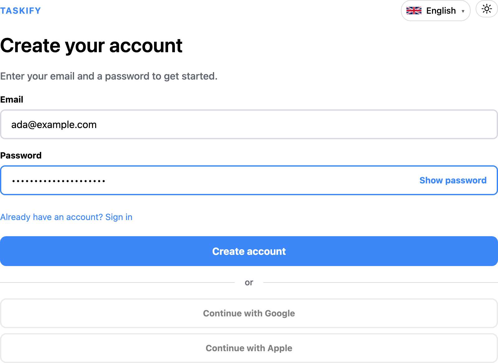
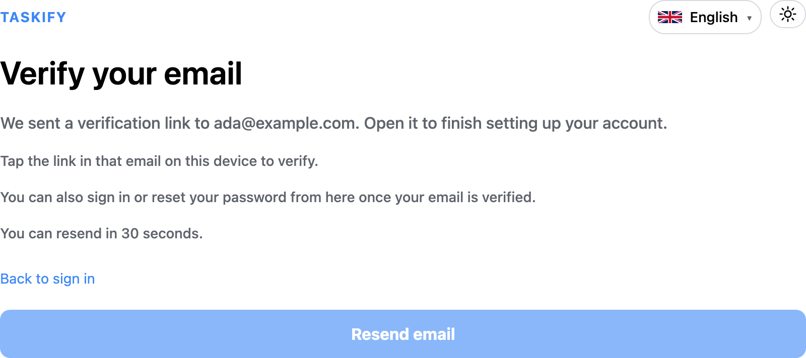
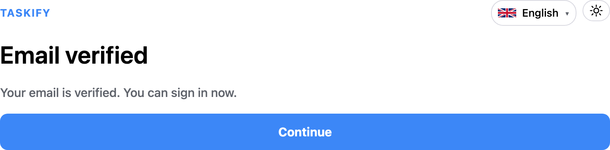
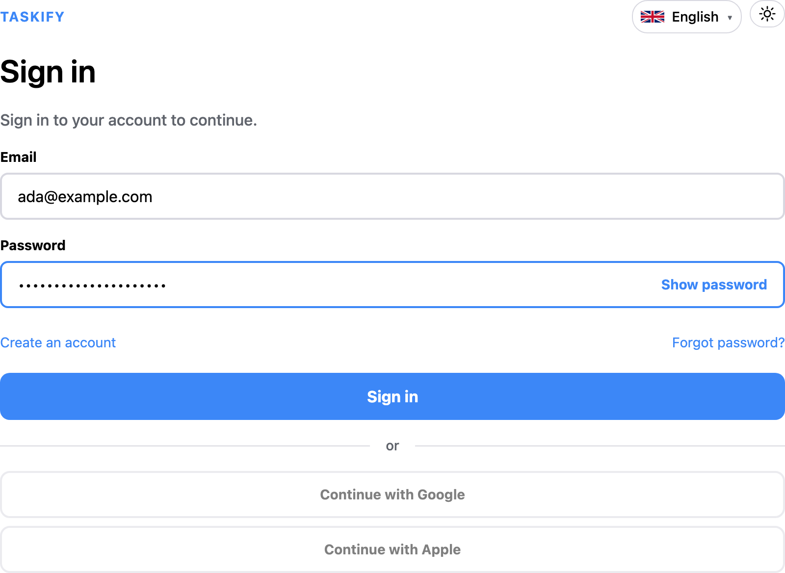
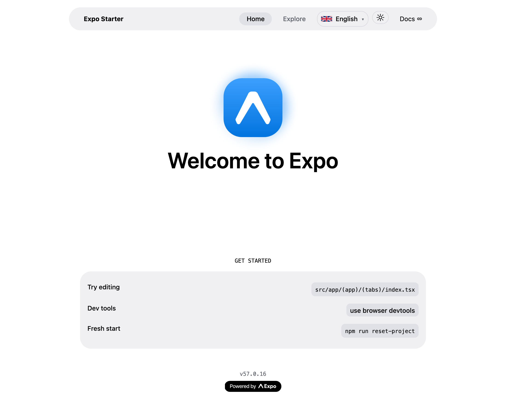

# Getting started: create an account in the web client

This walks through the same account flow as
[the API walkthrough](index.md), but from the browser: register, confirm the
address, and sign in.

Every screenshot below is captured from the running app by the end-to-end
suite, so what you see here is what the current code renders — see
[keeping the screenshots current](#keeping-the-screenshots-current).

## Prerequisites

Start Postgres and the backend, then the Expo web client:

```bash
cd backend
uv run uvicorn backend.main:app --reload
```

```bash
cd frontend
npm run web
```

The client reads `EXPO_PUBLIC_API_URL` at build time and falls back to
`http://localhost:8000`. The backend has to list the client's origin in
`CORS_ALLOWED_ORIGINS` — it defaults to `http://localhost:8081`, which is where
Expo serves the web bundle.

You also need somewhere for the verification email to land. Either run an SMTP
catcher such as [Mailpit](https://mailpit.axllent.org/) on `localhost:1025`
along with the Celery worker, or read the token straight out of the
`email_outbox` table as described in step 2.

## 1. Register

Open `http://localhost:8081/register`, enter an address and a password, and
select **Create account**.



The password must be at least 12 characters by default. The floor comes from
`PASSWORD_STRENGTH` on the backend, and the client mirrors it through
`EXPO_PUBLIC_PASSWORD_MIN_LENGTH` — set the two to different values and a
length rejection arrives as an error the screen cannot explain properly.

Registration always reports success, whether or not the address already had an
account, so the response cannot be used to discover who is registered.

## 2. Confirm the address

Registration hands you to the verify screen, which names the address it sent
to and offers a resend after a 30-second cooldown.



Open the link in the email. It points at the client, not the API
(`{FRONTEND_BASE_URL}/verify-email-confirm?token=...` — see
[the verification-link decision](../architecture/decisions/0004-email-verification-via-frontend.md)),
so the app can show a real screen instead of raw JSON.



Without a mail catcher running, take the token from the database and visit the
link yourself:

```bash
psql todoapp -c \
  "SELECT token FROM email_outbox WHERE email = 'you@example.com' ORDER BY created_at DESC LIMIT 1"
```

Then open `http://localhost:8081/verify-email-confirm?token=<token>`.

The screen reports the same "invalid or expired" outcome for a token that
never existed, one that has already been spent, and one that has timed out.

## 3. Sign in

Select **Continue**, then sign in with the address you just confirmed.



Signing in before confirming sends you back to the verify screen rather than
showing an error, because an unverified account is a step to finish rather
than a failure.

A wrong password and an address with no account produce the identical message,
**Email or password is incorrect** — again so the screen cannot be used to
enumerate accounts. That copy comes from the client's own translations, never
from the API; see [Show an auth error message](../guides/auth-error-messages.md)
and [the error-copy decision](../architecture/decisions/0005-frontend-owns-auth-error-copy.md).

## 4. You are in



The signed-in area is still the Expo starter screen — the frontend is a
reusable auth template first, and the todo product UI comes later.

From here the session maintains itself. The access token lasts 15 minutes; when
it expires the client exchanges the refresh token for a new pair and retries
the request, so you stay signed in without noticing. Presenting an already-used
refresh token is treated as theft and kills the whole session — see
[the reuse-detection decision](../architecture/decisions/0001-refresh-token-rotation-with-family-reuse-detection.md).

On the web the tokens live only in httponly cookies; the JavaScript never
touches them. Native builds use `Authorization: Bearer` with
`expo-secure-store` instead, which is why both delivery methods exist
([the dual-delivery decision](../architecture/decisions/0002-dual-cookie-and-body-token-delivery.md)).

## Keeping the screenshots current

The images above are produced by a Playwright capture that drives the real app,
asserting at each step, so it cannot record a broken screen. Re-run it after
any change to the auth screens:

```bash
cd e2e
npm run screenshots
```

It writes into `docs/assets/screenshots/` and is deliberately excluded from
`npm test`, so an ordinary test run never rewrites the documentation. The
capture lives in `e2e/screenshots/getting-started.spec.ts`.
