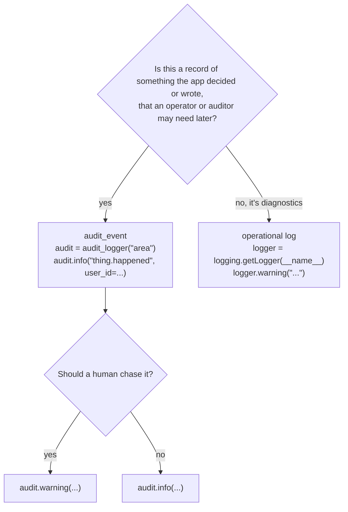
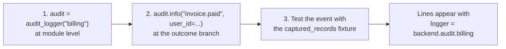
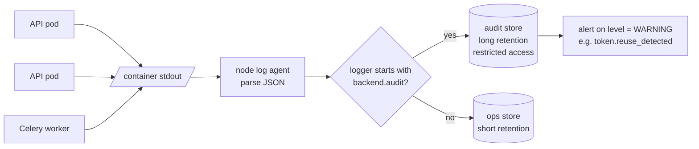
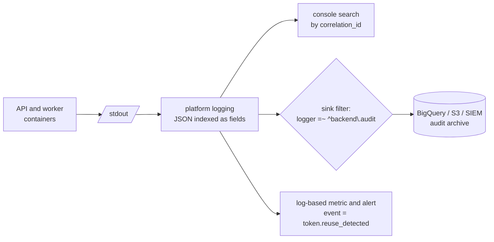

# Log from the backend

The backend writes every log line to stdout, one record per line. Ordinary
operational logs and `audit_event`s share the stream and are told apart by their
`logger` name. For the reasoning, see
[ADR 7](../architecture/decisions/0007-structured-logs-to-stdout-with-an-audit-stream.md).
For the API, see the [`backend.log` reference](../reference/log.md).

## Configure the output

Both settings are read from `backend/.env`, by the API and the Celery worker alike.

| Variable | Values | Default | Use |
|---|---|---|---|
| `LOG_FORMAT` | `console`, `json` | `console` | `console` for local development, `json` for anything that ships logs |
| `LOG_LEVEL` | `DEBUG`, `INFO`, `WARNING`, ... | `INFO` | The minimum severity the app emits |

A `json` line for one `audit_event`:

```json
{"timestamp": "2026-10-01T09:12:44.103+00:00", "level": "INFO",
 "logger": "backend.audit.auth", "correlation_id": "my-trace-id-42",
 "event": "user.registered", "ip_address": "203.0.113.7", "user_agent": "Mozilla/5.0 ...",
 "fields": {"user_id": "9272...", "method": "password"}}
```

An operational line has `message` in place of `event`, `ip_address` and `user_agent`.

## Pick the right logger



Emit one `audit_event` per action, at the branch where the outcome is decided.
Its consequences belong to what the event means: `logout` covers revoking that
session's tokens, and the `backend.audit.db` row writes carry the detail.

## Add an audit area

An area is a child of `backend.audit`, such as `backend.audit.auth`. Add one when
a new domain package starts recording its own events, for example a future
`billing` package.



1. Create the logger once, at module level, in each module that emits events:

    ```python
    from backend.log import audit_logger

    audit = audit_logger("billing")
    ```

    `audit_logger` is cached, so every module asking for `"billing"` shares one
    `AuditLogger`.

2. Call it like a logger. The first argument is the event name, every keyword
   becomes a field:

    ```python
    audit.info("invoice.paid", user_id=user.id, invoice_id=invoice.id)
    audit.warning("invoice.refund_refused", user_id=user.id, reason="already_refunded")
    ```

    Pass ids, never an email or a secret. A field named in `SENSITIVE_FIELDS`
    is written as `***`, but a secret under any other name goes through as is.

3. Assert on the event in the domain's tests. The `captured_records` fixture in
   `backend/tests/conftest.py` collects every record on `backend.audit`, as
   `tests/auth/test_audit_events.py` shows for `auth`.

A new repository write method in any area logs to the existing `db` area
instead, right after the write:

```python
audit = audit_logger("db")

audit.info("db_write", table=Invoice.__tablename__, operation="insert", invoice_id=invoice.id)
```

Nothing adds this call for you. A write method without it leaves no `db_write`.

## Quieten one area

Each area is its own logger, so its level can change without touching the
others. To drop the high-volume row writes but keep every other audit event:

```python
logging.getLogger("backend.audit.db").setLevel(logging.WARNING)
```

## Use the logs in production

Run every process with `LOG_FORMAT=json`. The backend keeps no copy of its logs,
so something must collect stdout. Both setups below pick out the audit stream with
the same rule: the `logger` field starts with `backend.audit`.

The tools named below are examples. Any collector that parses JSON lines and
filters on a field works the same way.

### Option 1: a collector agent splits the stream

A log agent on each node, such as Fluent Bit, Vector or Grafana Alloy, tails the
container output, parses each line as JSON and routes it by `logger`. Audit events
go to a store with long retention and restricted read access. Everything else goes
to the operational store with short retention.



Use this when you run your own cluster and want the audit trail held apart from
debugging logs.

### Option 2: the platform's logging service and a sink

On a managed platform (Google Cloud Logging, AWS CloudWatch Logs, Azure Monitor),
stdout is collected without any agent of yours, and JSON lines are indexed as
structured fields. One log-based sink or subscription filter copies the audit
stream to long-term storage, such as BigQuery, S3 or a SIEM. Everything stays
searchable in the platform console under its default retention.



Use this when the platform already collects container output and you would
rather not run an agent.

### Either way

- Search by `correlation_id` to see every line of one request, or every line of
  one Celery task, whose `correlation_id` is its task id. A client that sends
  `X-Request-ID` has it used as the `correlation_id`, after sanitising.
- Behind an ingress, start uvicorn with
  `--proxy-headers --forwarded-allow-ips=<ingress range>`, or every line's
  `ip_address` is the ingress.
- Alert on `level = WARNING` within `backend.audit`. That covers
  `token.reuse_detected` and the other events a human should chase.
